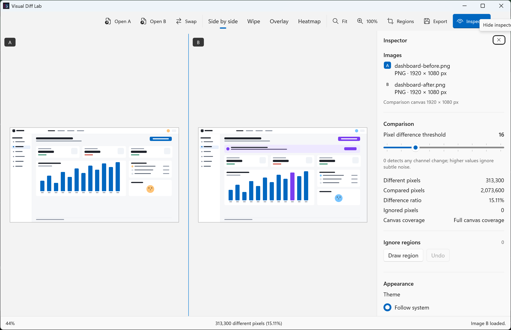
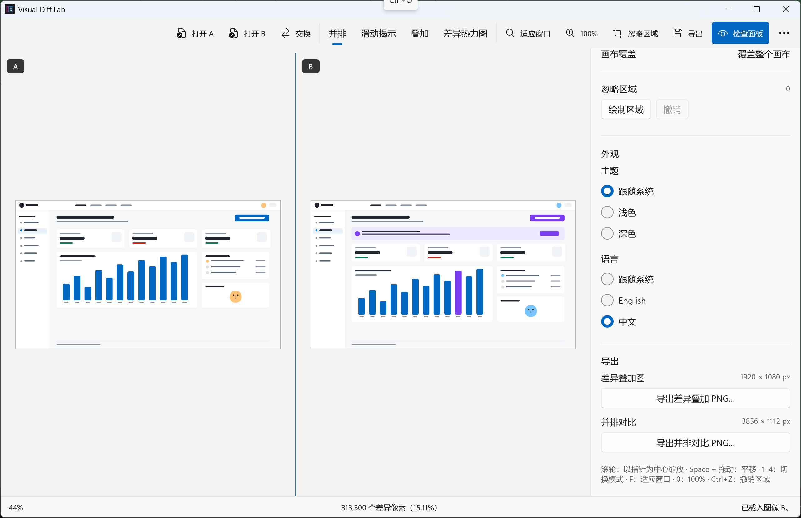

# Visual Diff Lab

Visual Diff Lab is a local-first native Windows workspace for inspecting visual differences between two UI screenshots. It is built with **WinUI 3 / Windows App SDK 2.5.1**, **Win2D 1.4.0**, and **.NET 10**.



Chinese UI: 

## What it does

- Open two local PNG, JPEG or BMP images with the file picker or drag and drop.
- Compare them with four modes: **Side by side**, **Wipe**, **Overlay** and **Difference heatmap**.
- Shared zoom and pan; wheel zoom is anchored at the pointer; `Fit` and true `100%` (one image pixel per physical screen pixel).
- Per-pixel difference threshold (0–64) with live statistics: different pixels, compared pixels, ratio and ignored pixels.
- Draw ignore rectangles in image coordinates, select them, delete them, and undo add/delete with `Ctrl+Z`.
- Export the **difference overlay PNG** or **side-by-side PNG** with a size confirmation before saving.
- Light, dark and system themes.
- English and Simplified Chinese UI, switchable in the Inspector (`Follow system` / `English` / `中文`). Defaults to the Windows preferred language on launch; the choice is not persisted between sessions.
- Everything is processed locally. There is no network access, account, telemetry or upload code path.

## Requirements

- **Windows 11 25H2 (build 26100) or later.** Verified on Windows 11 build 26200.
- **.NET SDK 10.0.402** (pinned by `global.json`). The machine used for development had no machine-wide SDK, so the SDK was installed per-user with `scripts/dotnet-install.ps1`.
- Visual Studio is not required; the solution builds with the .NET CLI. The local machine had Visual Studio 2022 17.8.3 available but it was not used for the build.
- A desktop session for running the app and the UI automation tests (WinUI 3 cannot run headless).
- Windows Developer Mode is only needed for the loose-layout MSIX registration used in verification.

## Build

```powershell
# from the repository root
$env:PATH = "$env:USERPROFILE\.dotnet;$env:PATH"   # if the SDK was installed per-user
dotnet restore .\VisualDiffLab.sln

# Libraries, tests, tooling (solution-level RuntimeIdentifier is not supported)
dotnet build .\VisualDiffLab.sln -c Release -p:Platform=x64

# WinUI app (requires a RID); repeat with -c Debug for a debug build
dotnet build .\src\VisualDiffLab.App\VisualDiffLab.App.csproj -c Release -p:Platform=x64 -r win-x64
```

The app executable is produced at:

```text
src\VisualDiffLab.App\bin\x64\Release\net10.0-windows10.0.26100.0\win-x64\VisualDiffLab.exe
```

Run it:

```powershell
.\src\VisualDiffLab.App\bin\x64\Release\net10.0-windows10.0.26100.0\win-x64\VisualDiffLab.exe
```

For automated UI runs the app accepts non-user-facing test hooks:

```powershell
VisualDiffLab.exe --a <absolute path to image A> --b <absolute path to image B> --lang en-US
```

`--lang` accepts `en-US`, `zh-CN` or `system`; without it, the app follows the Windows preferred language. The UI tests force `en-US` so their English assertions stay deterministic.

## Tests

```powershell
# Unit/integration tests (no UI desktop required)
dotnet test .\tests\VisualDiffLab.Core.Tests -c Release -p:Platform=x64
dotnet test .\tests\VisualDiffLab.Imaging.Tests -c Release -p:Platform=x64
dotnet test .\tests\VisualDiffLab.Rendering.Tests -c Release -p:Platform=x64

# UI automation, 8 tests (requires an interactive desktop and the built app)
$env:VDL_APP_CONFIG = "Release"
dotnet test .\tests\VisualDiffLab.UITests -c Debug -p:Platform=x64

# Localization key parity
python .\scripts\validate-localization.py
```

UI tests use **FlaUI / UIA3** against the real WinUI automation tree; see `docs/decisions/ADR-0003-ui-automation.md` for why Appium Windows Driver/WinAppDriver was not used. They drive modes, threshold changes, ignore regions, undo, themes, language switching, resize, exports through the native save dialog, import/swap/clear, and read the app's diagnostics log for first-frame performance.

## Performance

Measured on the development machine (AMD Ryzen 7 PRO 4750U, 16 logical processors, 48 GB RAM, Windows 11 build 26200, 200% DPI, 3840×2160 4K PNG fixtures):

| Scenario | Measurement | Target |
|---|---|---|
| Process start → first 4K difference visible | 1458 ms (includes app/WinUI startup) | — |
| Decode two 4K PNGs | 61.4 ms median (warm cache benchmark) | ≤ 2500 ms for load + diff |
| Diff in the real 4K app | 42 ms median / 51 ms max | ≤ 1500 ms |
| Mode switch, first frame | 9.1 ms median / 16.0 ms max | ≤ 100 ms |
| Threshold change including 120 ms debounce | 263 ms median / 268 ms max | ≤ 1500 ms |
| Working set after 4K workflows | 473 MB | ≤ 500 MB |

Full data and method: `docs/reports/performance.md`, `artifacts/performance/`.

## Architecture

```text
src/VisualDiffLab.App          WinUI 3 window, MVVM-lite state, dialogs, canvas interaction
src/VisualDiffLab.Core         Pure comparison algorithm, ignore regions, statistics, PNG pixel composition
src/VisualDiffLab.Imaging      WIC decoding/encoding, normalization to BGRA8 premultiplied sRGB
src/VisualDiffLab.Rendering    Win2D renderer, view transform, mode layout, overlays
src/VisualDiffLab.App/Localization  Embedded en-US/zh-CN JSON dictionaries + in-app language service
tests/…                        71 deterministic unit/integration tests + 8 UI automation tests
tools/VisualDiffLab.Benchmark  Reproducible warm-cache CPU benchmark
```

Dependency direction: `App → Rendering → Core`, `App → Imaging → Core`.

## Keyboard shortcuts

| Shortcut | Action |
|---|---|
| `Ctrl+O` | Choose image A or B to open/replace |
| `Ctrl+E` | Open export menu |
| `1` / `2` / `3` / `4` | Side-by-side / Wipe / Overlay / Heatmap (canvas focused) |
| `F` | Fit to view |
| `0` | 100% original pixels |
| `Space + drag` | Pan |
| `Esc` | Cancel region drag / leave region mode / clear selection |
| `Ctrl+Z` | Undo last ignore-region add/delete |
| `Delete` | Delete selected region |
| Left / Right | Move wipe split (Wipe mode, canvas focused) |
| Mouse wheel | Zoom at pointer |

## Documentation

- Product/algorithm rules: `docs/product/algorithm-rules.md`
- Design notes and references: `docs/design/`, `docs/design/references/references.md`
- Decisions (ADRs): `docs/decisions/`
- Testing and acceptance: `docs/testing/manual-acceptance.md`
- Phase reports: `docs/reports/`
- Privacy: `docs/privacy.md`

## Known limitations (honest summary)

- The MSIX package is **unsigned** in this repository; installation verification used a loose-layout `Add-AppxPackage -Register` on a Developer Mode machine. A signed package and clean-machine install are not verified.
- The Windows 11 **26H2** environment was not available; only build 26200 (25H2) was tested.
- **License selection is pending the project owner**; see `LICENSE` and `docs/decisions/DEFERRED.md`.
- GitHub Actions workflows are authored but were not executed on GitHub from this environment.
- Narrator/high-contrast review and ARM64 execution are not verified.
- The language choice is session-only; it is not persisted across launches. Additional languages are not provided.
- Native file dialogs follow the Windows UI language, not the in-app language selector.
- Drag-and-drop import is implemented but not covered by the automated/manual acceptance runs; file-picker import is verified.
- ICC-profile conversion behavior was not exercised with a custom ICC fixture.
- See `docs/reports/release-readiness.md` for the complete checklist and blockers.
